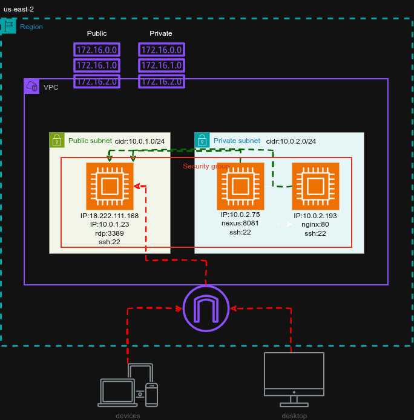

# Requerimiento
Se nos solicito la implementacion de un repositorio privado, vamos a 
implementarlo con Nexus en su version community.
# Arquitectura
Se debe emplear una arquitectura en donde se tenga una VPC que va contar 
con dos Subnet's (privada y publica), esta VPC tambien va contar con dos Route Tables
(privada y publica), se van a tener tres instancias ec2, una de las instanicas 
se va encontrar en la subnet publica y va tener la funcion de trabajar como una
instancia nat para que las instancias que van a estar en la subnet privada tenga
salida a internet.



# Requisitos previos 
1. AWS CLI 
2. Terraform
3. Ansible
4. Remmina

# Solucion 
Para levantar toda la arquitectura vamos a utilizar **Terraform**, de igual modo 
vamos a necesitar que se tenga configurada **AWS CLI** con la cuenta que se va 
utilizar para la implementacion de la infraestructura.
Luego vamos a crear las llaves **GPG** para el la creacion de nuestro repositorio.
Siguiendo con la instalacion vamos copiar el directorio ansible en la instancia 
publica para la instalacion de Nexus.
Despues de que finalice la instalacion de Nexus nos vamos a dirigir a la otra 
instancia y vamos a realizar la configuracion necesaria para que nuestro servidor
puede instalar los paquetes de nuestro repositorio privado.

# Desplegar infraestructura 
```
terraform plan --out main-plan.tfplan
terraform apply main-plan.tfplan
```
# Copiar nginx-custom_1.26.1_amd64.deb 
```
scp -i infra-terraform/nexus-kp.pem infra-terraform/nginx-custom_1.26.1_amd64.deb ubuntu@3.148.228.118:/home/ubuntu/
```
# Copiar llave 
```
scp -i infra-terraform/nexus-kp.pem infra-terraform/nexus-kp.pem ubuntu@3.148.228.118:/home/ubuntu/
```
# Copiar directorio ansible 
```
scp -i infra-terraform/nexus-kp.pem -r ansible/ ubuntu@3.148.228.118:/home/ubuntu/
```
# Configurar a la instancia publica 
```
infocmp -x | ssh -i infra-terraform/nexus-kp.pem ubuntu@<IP PUBLICA> -- tic -x -
ssh -i infra-terraform/nexus-kp.pem ubuntu@3.148.228.118
```
## Configurar inventory
Se deben acutalizar las IP y realizar una prueba de ping 
```
cd ansible 
ansible all -m ping -i inventory 
```
## Instalar Nexus con Ansible 
```
ansible-playbook -i inventory playbook.yml 
```
# Ingresar a la instancia publica  
Vamos a ingresar a la instancia publica desde **Remmina** esto con el proposito de 
configurar **Nexus** desde la UI.
Previamente vamos a asignarle una contrasena a nuestro usuario _ubuntu_ porque nos
lo va solicitar **Remmina**.
```
sudo passwd ubuntu 
```
Le asignamos una contrasena y no la tenemos que olvidar.
Ahora si podemos ingresar desde **Remmina** y nos va solicitar usuario y contrasena.
# Ingresar a servidor privado Nexus 
Debemos crear las llaves PGP para configurar **Nexus**. Nos encotramos en el 
servidor publico desde donde tenemos llegada a los servidores privados.
```
infocmp -x | ssh -i nexus-kp.pem ubuntu@10.0.2.XXX -- tic -x -
ssh -i nexus-kp.pem ubuntu@<IP_PRIVADA de la instacia Nexus>
ssh -i nexus-kp.pem ubuntu@10.0.2.XXX
```
## Crear llave GPG 
```
gpg --full-generate-key
```
## Listar llaves
```
gpg --list-keys --keyid-format LONG
```
### Exportar llave privada 
```
gpg --armor --export-secret-keys <REEMPLAZAR IDENTIFICADOR> > mi_llave_privada.asc
```
### Exportar llave publica 
```
gpg --armor --export <REEMPLAZAR IDENTIFICADOR> > mi_repositorio.pub
```
# Configurar Nexus 
Una ves dentro de la instancia publica abrimos el navegador y colocamos en la barra 
de navegacion la **IP PRIVADA Y PUERTO** de la instancia donde estamos intalando 
**Nexus**.
Para obtener la contrasena del usuario **admin** ejecutamos el siguiente comando
```
cat /opt/sonatype-work/nexus3/admin.password
```
Una ves ingresamos nos va solicitar que cambiemos la contrasena.
## Crear usuario
Nos vamos a dirigir **Settings**(Rueda dentada)->Security->User luego damos click 
en crear usuario.
## Crear repositorio 
Nos dirigimos a **Repositories** y luego damos click sobre **Create repository** y seleccionamos _apt (hosted)_, le asignamos un nombre, distribucion y le agregamos 
la llave privada (mi_llave_privada.asc)
Despues de ser creado nuestro repositorio debemos copiar la URL para poder 
realizar la instalacion de los paquetes en los servidores clientes.
# Configurar servidor cliente
Nos ubicamos en el servidor publico y desde ahi copiamos la llave para ingresar
al servidor cliente.
```
scp -i nexus-kp.pem nexus-kp.pem ubuntu@<IP PRIVADA de la instancia cliente>:/home/ubuntu

scp -i nexus-kp.pem nexus-kp.pem ubuntu@10.0.2.xx:/home/ubuntu
```
## Ingresar al servidor cliente
```
infocmp -x | ssh -i nexus-kp.pem ubuntu@10.0.2.XXX -- tic -x -
ssh -i nexus-kp.pem ubuntu@<IP PRIVADA de la instancia cliente>
ssh -i nexus-kp.pem ubuntu@10.0.2.XXX
```
## Copiar llave publica PGP
Vamos a copiar la llave publica que se encuentra en el servidor Nexus
```
scp -i nexus-kp.pem ubuntu@<IP PRIVADA de la instancia nexus>:/home/ubuntu/mi_repositorio.pub .

scp -i nexus-kp.pem ubuntu@10.0.2.xx:/home/ubuntu/mi_repositorio.pub .
```
### Agregar llave publica PGP 
```
sudo gpg --dearmor -o /etc/apt/trusted.gpg.d/nexus_internos.gpg mi_repositorio.pub
```
### Agregar repositorio 
```
sudo vi /etc/apt/sources.list.d/nexus_internos.sources
```

```
X-Reponame: Nexus_Paquetes_Internos
Types: deb
URIs: http://<IP PRIVADA instancia Nexux>:8081/repository/paquetes_internos/
Suites: jammy
Components: main
Signed-By: /etc/apt/trusted.gpg.d/nexus_internos.gpg
Trusted: yes
```
### Agregar usuario y contrasena para autenticar repositorio
```
sudo vi /etc/apt/auth.conf.d/nexus.conf
```

```
machine http://<IP PRIVADA instancia Nexus>:8081/repository/paquetes_internos/ login pier password xxxxxxx
```
#### Limpiar repositorio
```
sudo apt clean 
```
#### Actualizar repositorio 
```
sudo apt update 
```
# Verificar
Vamos a verificar que nuestro paquete ya esta disponible para instalarse.
```
sudo apt search nginx-custom
sudo apt install nginx-custom 
```
Nos dirigimos a **Remmina**, ingresamos al servidor publico y abrimos el 
navegador y en la barra de navegacion colocamos la **IP PRIVADA** de la instancia cliente y debe aparecer nuestro **Nginx** personalizado.
# Eliminar infraestructura
```
terraform plan -destroy --out main-plan-destroy.tfplan
terraform apply main-plan-destroy.tfplan
```
# OTROS COMANDOS
#### Ver las IP's publicas y privadas
```
terraform output
```
#### Listar tipos de instancias disponibles para tier
```
aws ec2 describe-instance-types \
    --filters Name=free-tier-eligible,Values=true \
    --region us-east-2 \
    --query "InstanceTypes[].{Type:InstanceType,CPU:VCpuInfo.DefaultVCpus,Memory:MemoryInfo.SizeInMiB}" \
    --output table
```
#### Ver estado de las instancias
```
aws ec2 describe-instances \
    --filters Name=tag:USER,Values=SNOW \
    --query "Reservations[].Instances[].{ID:InstanceId,ESTADO:State.Name,Nombre:Tags[?Key=='Name'].Value | [0]}" \
    --output table
```


